<div align="center">

[Русский](README.md) · **English**

<br>



<a href="https://github.com/sailxx/Okto-Calc/releases/latest/download/OktoCalc.apk"></a>&nbsp;&nbsp;<a href="https://github.com/sailxx/Okto-Calc/releases/latest"></a>

**Okto Calc is an Android calculator with the features of Google Calculator and rounded keys.** Percent, brackets, scientific functions, history and four visual themes — in one light app with no ads, no accounts and no internet. A sibling of [Okto](https://github.com/sailxx/Okto) and [Okto Notes](https://github.com/sailxx/Okto-Notes).

</div>

<br>



<details>
<summary><b>More about the features</b></summary>

### 🧮 Calculations

Just like Google Calculator: **percent is taken from the left operand** (`50 + 10%` = 55, `50 × 10%` = 5), the smart `( )` key picks the right bracket, missing brackets close themselves, and `2π` or `3(1+3)` work without a multiplication sign. Powers, square root, factorial; results are rounded to 12 significant digits (`0.1 + 0.2` = 0.3), and huge or tiny numbers use `1.5E12` notation. Errors are readable: “Can't divide by 0”, “Invalid input”.

### 📐 Scientific functions

The **f(x)** button on the display opens a panel: `sin` `cos` `tan`, `ln` `log`, `π` `e`, `xʸ` `x²` `x⁻¹` `x!` `√` `|x|`. **Inv** swaps them for the inverses: `sin⁻¹`, `cos⁻¹`, `tan⁻¹`, `eˣ`, `10ˣ`, `x³`. Angles are **degrees or radians** (the DEG/RAD switch on the display); `sin(180°)` gives exactly 0. In landscape the scientific keys always sit to the left of the main ones.

### 🕘 History

Every calculation is stored on the phone (last 100). Tap a row to drop its result into the expression; “Clear” wipes the list.

### ✋ Convenience

The result shows up **while you type** — in grey under the expression. Long-press the display to copy the result, long-press `⌫` to clear everything. Long numbers are grouped (`1 234 567`), and haptic feedback can be switched off.

</details>

<br>



<details>
<summary><b>How themes work</b></summary>

Open the settings with the “Settings” button on the display. The palettes are the same as in [Okto Notes](https://github.com/sailxx/Okto-Notes).

- **Color** — the main theme: soft tonal keys; a pressed circle squeezes into a rounded square; Nunito font.
- **Okto** — graphite in the style of [Okto](https://sailxx.github.io/Okto/): a sunken display, raised keys with a shadow underneath, Golos Text and JetBrains Mono.
- **Okto Light** — the white version of Okto: the same display and keys on a light background.
- **Custom** — pick the layout (Color or Okto), light or dark mode, and tune hue and saturation with sliders. The whole palette — background, display and keys — is built from one color, and changes are instant.

</details>

<br>



<details>
<summary><b>Installation</b></summary>

1. Download [`OktoCalc.apk`](https://github.com/sailxx/Okto-Calc/releases/latest/download/OktoCalc.apk).
2. Open the file on your phone and allow installation from unknown sources.
3. Done — Android 8.0 and newer.

</details>

<details>
<summary><b>Development</b></summary>

Kotlin 2.2 + Jetpack Compose (Material 3), no third-party dependencies. The evaluator is a hand-written recursive-descent parser covered by unit tests.

```bash
./gradlew testDebugUnitTest   # evaluator tests
./gradlew assembleRelease     # APK in app/build/outputs/apk/release/
```

Requires JDK 17+ and the Android SDK (platform 35).

README images are generated in every language (texts live in `tools/readme/strings.json`) — don't edit the SVGs by hand:

```bash
cd tools/readme && npm install && node build.mjs
```

```
app/src/main/java/com/sailxx/oktocalc/
├── MainActivity.kt   — entry point, screens, theme
├── Engine.kt         — expression parsing, evaluation, formatting
├── CalcState.kt      — input, live preview, history
├── CalcScreen.kt     — display and layouts (portrait and landscape)
├── Keys.kt           — the rounded key for both layouts
├── Panels.kt         — history and settings
└── Theme.kt          — palettes, fonts, strings, settings
```

Nunito, Golos Text and JetBrains Mono fonts — SIL Open Font License 1.1.

</details>
