<div align="center">

**Русский** · [English](README.en.md)

<br>



<a href="https://github.com/sailxx/Okto-Calc/releases/latest/download/OktoCalc.apk"></a>&nbsp;&nbsp;<a href="https://github.com/sailxx/Okto-Calc/releases/latest"></a>

**Okto Calc — калькулятор для Android с функциями Google Калькулятора и скруглёнными клавишами.** Проценты, скобки, инженерные функции, история и четыре темы оформления — в одном лёгком приложении без рекламы, аккаунтов и интернета. Брат [Okto](https://github.com/sailxx/Okto) и [Okto Notes](https://github.com/sailxx/Okto-Notes).

</div>

<br>



<details>
<summary><b>Подробнее о возможностях</b></summary>

### 🧮 Вычисления

Как в Google Калькуляторе: **проценты считаются от левой части** (`50 + 10%` = 55, `50 × 10%` = 5), скобки подставляются умной кнопкой `( )`, недостающие скобки закрываются сами, а `2π` и `3(1+3)` понимаются без знака умножения. Степень, квадратный корень, факториал; результат округляется до 12 значащих цифр (`0.1 + 0.2` = 0.3), большие и малые числа — в виде `1.5E12`. Ошибки названы по-человечески: «Нельзя делить на 0», «Недопустимое значение».

### 📐 Инженерные функции

Кнопка **f(x)** на табло раскрывает панель: `sin` `cos` `tan`, `ln` `log`, `π` `e`, `xʸ` `x²` `x⁻¹` `x!` `√` `|x|`. Кнопка **Inv** меняет их на обратные: `sin⁻¹`, `cos⁻¹`, `tan⁻¹`, `eˣ`, `10ˣ`, `x³`. Углы — **градусы или радианы** (переключатель DEG/RAD на табло), `sin(180°)` даёт ровно 0. В альбомной ориентации инженерные клавиши всегда слева от основных.

### 🕘 История

Каждое вычисление сохраняется на телефоне (последние 100). Тап по строке подставляет результат в выражение, «Очистить» стирает всё.

### ✋ Удобство

Результат виден **ещё во время набора** — серым под выражением. Долгое нажатие на табло копирует результат, на `⌫` — очищает всё. Цифры в длинных числах разделены пробелами (`1 234 567`), вибро-отклик можно выключить.

</details>

<br>



<details>
<summary><b>Как работают темы</b></summary>

Настройки открываются кнопкой «Настройки» на табло. Палитры те же, что в [Okto Notes](https://github.com/sailxx/Okto-Notes).

- **Цветная** — основная тема: мягкие тональные клавиши, при нажатии круг «сжимается» в скруглённый квадрат, шрифт Nunito.
- **Okto** — графит в стиле [Okto](https://sailxx.github.io/Okto/): утопленное табло, объёмные клавиши с тенью снизу, Golos Text и JetBrains Mono.
- **Okto Light** — белая версия Okto: то же табло и клавиши на светлом фоне.
- **Своя** — выбери оформление (Цветное или Okto), светлый или тёмный режим и подбери оттенок и насыщенность ползунками. Вся палитра — фон, табло и клавиши — строится из одного цвета, изменения видны сразу.

</details>

<br>



<details>
<summary><b>Установка</b></summary>

1. Скачай [`OktoCalc.apk`](https://github.com/sailxx/Okto-Calc/releases/latest/download/OktoCalc.apk).
2. Открой файл на телефоне и разреши установку из неизвестных источников.
3. Готово — Android 8.0 и новее.

</details>

<details>
<summary><b>Разработка</b></summary>

Kotlin 2.2 + Jetpack Compose (Material 3), без сторонних зависимостей. Вычислитель — собственный рекурсивный парсер, покрытый тестами.

```bash
./gradlew testDebugUnitTest   # тесты вычислителя
./gradlew assembleRelease     # APK в app/build/outputs/apk/release/
```

Нужны JDK 17+ и Android SDK (platform 35).

Картинки README генерируются на всех языках (тексты — в `tools/readme/strings.json`), не правь SVG руками:

```bash
cd tools/readme && npm install && node build.mjs
```

```
app/src/main/java/com/sailxx/oktocalc/
├── MainActivity.kt   — точка входа, экраны, применение темы
├── Engine.kt         — разбор и вычисление выражений, форматирование
├── CalcState.kt      — ввод, предпросмотр результата, история
├── CalcScreen.kt     — табло и раскладки (книжная и альбомная)
├── Keys.kt           — скруглённая клавиша обеих раскладок
├── Panels.kt         — история и настройки
└── Theme.kt          — палитры, шрифты, строки, настройки
```

Шрифты Nunito, Golos Text и JetBrains Mono — SIL Open Font License 1.1.

</details>
